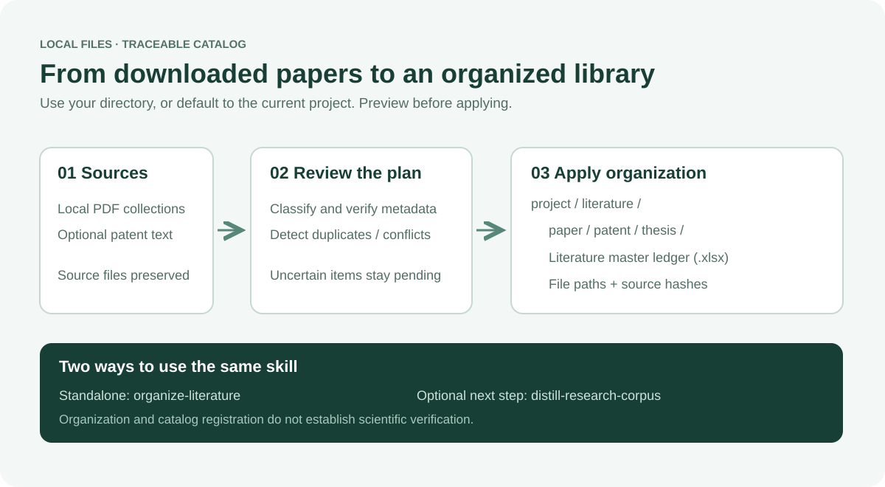

# Literature Organizer

**Local PDFs → consistent filenames → a searchable Excel master ledger.**

[中文说明](README.zh-CN.md) · [Skill instructions](SKILL.md) · [Metadata overrides](references/metadata-overrides.md)



## What it does

Classifies local scholarly documents, detects duplicates, copies them into a consistent layout, and maintains `literature-ledger.xlsx`. It combines the former personal `organize-academic-pdfs` and `ingest-literature` skills. It can run independently or as an optional intake subskill of [distill-research-corpus](https://github.com/zz11ss11zz/distill-research-corpus).

The default is the current project (or working directory) with this output:

```text
project/
└── literature/
    ├── paper/       # <venue> - <year> - <title>.pdf
    ├── patent/      # <publication-number> - <year>.<ext>
    ├── thesis/      # <school> - <year> - <title>.pdf
    ├── literature-ledger.xlsx
    └── _organization_manifest.json
```

User-specified source and destination directories take precedence. Original files are preserved by default; the output tree is excluded from later source scans. Missing metadata remains unresolved rather than being guessed. Preview does not create the library.

## Install and invoke

Requires Python 3.11+, `pypdf` and `openpyxl`.

```sh
git clone https://github.com/zz11ss11zz/organize-literature.git
python -m pip install -r organize-literature/requirements.txt
```

For skill discovery, place the repository directory in your environment's skills directory, named `organize-literature`. In Codex, this is normally `~/.codex/skills/organize-literature`. Install either this standalone version or the bundled child from `distill-research-corpus`; avoid maintaining two discoverable copies.

Example requests:

> Use $organize-literature to organize this project's downloaded documents into paper, patent and thesis folders and create the Excel ledger.

> Organize PDFs from my specified downloads directory into my specified literature directory. Preview unresolved metadata and conflicts first.

## Command-line preview and apply

Run from the current project and replace `<skill>` with the absolute installation path:

```sh
python <skill>/scripts/organize_academic_pdfs.py --root . --no-crossref
# After inspecting the plan:
python <skill>/scripts/organize_academic_pdfs.py --root . --no-crossref --apply
```

Explicit paths and verified metadata overrides:

```sh
python <skill>/scripts/organize_academic_pdfs.py --source /path/to/downloads --output /path/to/literature --overrides /path/to/metadata.json --no-crossref
```

Repeat the reviewed command with `--apply` to copy files and update the ledger. Sources must be outside the destination tree. Remove `--no-crossref` to allow DOI metadata lookup at Crossref; local filenames/automatic metadata are not independent verification. See [override examples](references/metadata-overrides.md) for paper, thesis, patent and exclusion records.

## Excel master ledger

`literature-ledger.xlsx` contains category, title, authors, year, venue/school, DOI, patent number, relative file path, SHA-256 and original path. It has filters, a frozen header and readable column widths. Incremental runs preserve prior rows; they do not remove missing documents from the ledger automatically. An existing incompatible workbook schema is rejected for adaptation rather than overwritten. Keep the workbook closed while updating it.

## Existing project library registration

The optional [legacy ingestion mode](references/ingestion.md) verifies bibliographic metadata, assigns project registration IDs and synchronizes supported CSV/Markdown/JSON catalogs. It is intended for existing project contracts, not for creating a second catalog by default. Its helper requires a DOI and supported PDF; those restrictions do not apply to thesis/patent organization. The two helpers are separate operations, not a single atomic transaction. Reconcile final paths and catalogs when combining them.

This skill organizes sources; manuscript writing, citation formatting, OCR and scientific evidence extraction are separate tasks. The parent corpus skill runs its own profile-based preflight and extraction after authorized intake is complete. File registration does not verify a scientific claim.

## Safety and limitations

- Default apply copies documents and preserves source bytes. Delete exact duplicates only when explicitly requested.
- Different bytes at the same target filename block apply; unresolved classification metadata also blocks the batch.
- Same-DOI editions are reported as bibliographic duplicates; default selection does not erase alternate source files.
- Scanned PDFs may need metadata overrides; no standalone OCR workflow is supplied here.
- Metadata services are optional. No document upload or telemetry is added.
- Copying PDFs and saving catalogs are not a whole-batch transaction. An interruption or locked workbook can leave copied files; report partial results and rerun after resolving the cause.

## Tests and provenance

```sh
python -B -m unittest discover -s scripts -p "test_*.py" -v
```

Offline synthetic fixtures cover preview, naming, conflict protection, duplicate registration, default layout and incremental Excel retention. Tests do not establish extraction accuracy on arbitrary real documents or online metadata quality.

These helpers were consolidated from the repository owner's local custom skills. No research documents or personal project data are bundled. No open-source license has been selected; public visibility alone is not a license grant.
