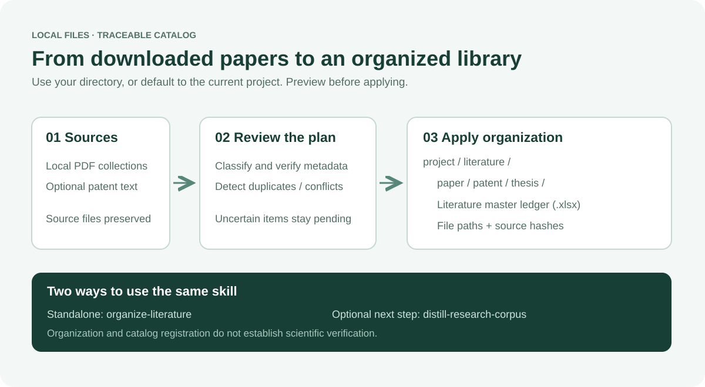

# 文献整理 organize-literature

[English](README.md) · [完整使用规则](SKILL.md)

将本地下载的文献整理成分类目录、规范文件名和 Excel 总账。可单独使用，也可作为 [distill-research-corpus](https://github.com/zz11ss11zz/distill-research-corpus) 的文献整理子 Skill。



## 默认目录与命名

优先采用用户指定的源目录和目的目录。未指定时，以当前项目（没有项目时为当前工作目录）为源，在其下生成：

```text
literature/
├── paper/      # 期刊 - 年份 - 标题.pdf
├── patent/     # 公开号 - 年份.pdf（也支持显式启用的专利 Markdown）
├── thesis/     # 学校 - 年份 - 标题.pdf
├── literature-ledger.xlsx
└── _organization_manifest.json
```

总账字段：分类、标题、作者、年份、期刊或学校、DOI、专利号、相对文件路径、SHA-256、原始路径。支持筛选、冻结首行、增量保留已有记录。源文件默认保留，不会自动删除；扫描时排除整理目的目录。

## 安装与使用

需要 Python 3.11+。克隆本仓库后运行 `python -m pip install -r requirements.txt`，再将仓库放入 Skill 目录，例如 `~/.codex/skills/organize-literature`。独立版与蒸馏集成版择一安装。

可以直接说：

> 用 $organize-literature 整理当前项目的文献，按 paper、patent、thesis 分类重命名，并生成 Excel 总账。

> 将指定下载目录的文献整理到指定的 literature 目录，先检查分类与重名冲突。

命令行（将 `<skill>` 换成安装目录的绝对路径）：

```sh
python <skill>/scripts/organize_academic_pdfs.py --root . --no-crossref
# 核对预览后执行：
python <skill>/scripts/organize_academic_pdfs.py --root . --no-crossref --apply
```

指定目录时使用 `--source <下载目录> --output <整理目的目录>`；指定核实过的元数据可使用 `--overrides <metadata.json>`，格式见[覆盖记录示例](references/metadata-overrides.md)。源文献应位于目的目录之外。`--no-crossref` 为离线模式，去掉后可按 DOI 查询 Crossref；缺少分类依据时保留待核，不编造信息。

## 边界与验证

默认复制并保留原文件；只有明确要求时才删除精确重复项。同名不同内容、元数据未解决会阻止执行。Excel 应在更新前关闭；整批复制和台账写入不是单一事务，中断时须核对部分完成项。增量保留的总账行不会随文件缺失自动删除。

执行 `python -B -m unittest discover -s scripts -p "test_*.py" -v` 运行离线模拟测试。测试覆盖预览、分类命名、冲突保护、重复入库、默认目录和 Excel 增量保留，不代表真实扫描件或在线元数据准确率。

此项目由作者本地自建的两个 Skill 合并而来，不包含真实文献或个人项目资料。尚未选定开源许可证；公开可见不等于授予开源许可。
